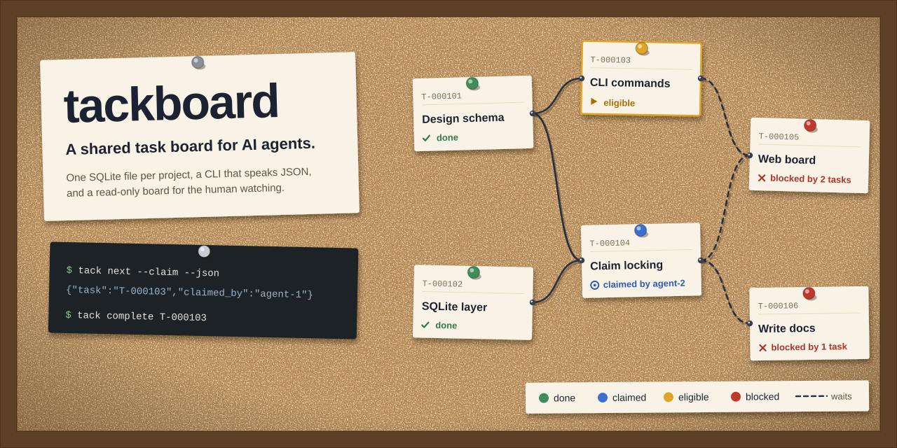

# tackboard




A small, reliable, project-scoped task board for coordinating multiple AI
agents — one SQLite database per project, a predictable CLI (`tack`) as the
primary interface, and a read-only web view for the human operator.

A codebase with several agents working at once needs three
things that a chat transcript cannot give it: a durable record of what is
still open, a way for one agent to hand work to another without stepping on
it, and a machine-readable answer to "what should I do next?". `tackboard`
provides exactly those, and nothing more:

- **One authoritative database per project.** A project is a SQLite file. Two
  projects never share a task-ID namespace and dependencies never cross files.
- **The CLI is an API.** Every command can emit a versioned JSON document, and
  exit codes are a stable contract, so an agent never has to scrape a table.
- **Tasks form a dependency DAG.** A task declares its prerequisites; readiness
  is *derived* from the graph, so a reopened prerequisite immediately changes
  who can start what.
- **Claims prevent collisions.** A claim is a short-lived lock held by one
  agent on one task; taking the next task and locking it happen in one
  transaction, so two agents racing for work never get the same task. A claim
  never writes the assignment: `assignee` is a long-lived routing note, written
  only by an explicit routing command (`create --assignee` / `update
  --assignee`).
- **A human can watch.** A read-only board and dependency-graph view serves the
  operator while agents work.

Installation, the CLI contract, the semantics, and troubleshooting are all
below; `DESIGN.md` describes the architecture for contributors.

## Install

Install the `tack` command from PyPI:

```bash
uv tool install tackboard    # install `tack` for your user
tack --help

uvx tackboard --help         # or run it once without installing
pip install tackboard        # or with pip
```

`tack` is the console entry point (`tackboard.cli:main`). `python -m tackboard`
runs the same CLI, so an environment that cannot install scripts can still be
driven by a module invocation. Python 3.12; the only runtime dependency is the
standard library.

### Install from source

For development, work from a checkout:

```bash
uv sync                  # development install into .venv (includes test tools)
uv run tack --help       # the CLI, from the checkout

uv tool install .        # or install the `tack` command from the checkout
tack --help
```

## Create a board

```bash
tack init --db .tackboard/project.sqlite3 --json
```

`init` creates the parent directories, writes the schema, records the project
label and creation time, and enables WAL. It is idempotent: running it against
a board that already exists never erases tasks. Against a non-empty SQLite file
that is not a board it fails with exit 6 rather than touching the file.

The command is the only one that creates a database. Every other command
refuses to run against a missing file instead of silently creating one.

## Choosing which board a command acts on

Every command that touches project data resolves the database in this order:

1. `--db PATH`
2. the `TACKBOARD_DB` environment variable
3. the nearest `.tackboard.toml`, searched from the current directory upwards

Relative paths given to `--db` and `TACKBOARD_DB` resolve against the current
working directory; paths inside `.tackboard.toml` resolve against that file's
directory. If nothing can be resolved, the command fails with exit 3 and says
what to do.

Two workflows are supported.

**A — commit the configuration, ignore the database.** Check in
`.tackboard.toml`:

```toml
[tackboard]
db = ".tackboard/project.sqlite3"
```

and ignore the database and its sidecars in `.gitignore`:

```gitignore
.tackboard/
*.sqlite3
*.sqlite3-wal
*.sqlite3-shm
```

Any command run from inside the project then finds the board with no flags.

**B — commit nothing, use the environment.**

```bash
export TACKBOARD_DB=/somewhere/shared/project.sqlite3
```

This suits a board that is deliberately outside the repository, or several
boards selected per shell.

> **Do not commit a live SQLite file.** The board is written to while agents
> work, and a committed copy goes stale the moment anyone claims a task; git
> will also conflict on the `-wal`/`-shm` sidecars, which are not mergeable.
> Commit `.tackboard.toml` (workflow A) or nothing at all (workflow B), never
> the database. To hand a board to someone, use `tack backup` — it takes a
> consistent snapshot even while agents are writing.

## Commands

```text
tack init --db PATH
tack migrate
tack backup PATH
tack board [filters/options]
tack list [filters/options]
tack show TASK_ID
tack create TITLE [options]
tack update TASK_ID [options]
tack status TASK_ID STATUS [mutation options]
tack complete TASK_ID [mutation options]
tack reopen TASK_ID [mutation options]
tack cancel TASK_ID [mutation options]
tack restore TASK_ID [mutation options]
tack note TASK_ID TEXT [--agent ID]
tack memo [TEXT | --file PATH | - | --edit | --append TEXT | --rev N
           | --history | --diff [N [N]] | --restore N | --clear]
          [--if-rev N] [--reason TEXT] [--force] [--dry-run] [--limit N]
tack claim TASK_ID [--agent ID] [--force --reason TEXT] [--if-version N]
tack release TASK_ID [--agent ID] [--force --reason TEXT] [--if-version N]
tack claims [--agent ID] [--older-than DURATION]
tack next [--agent ID] [--claim] [--stage work|review] [--force --reason TEXT] [filters]
tack depend add TASK_ID --on PREREQUISITE_ID [--agent ID] [--if-version N] [--force --reason TEXT]
tack depend remove TASK_ID --on PREREQUISITE_ID [--agent ID] [--if-version N]
tack deps TASK_ID
tack dependents TASK_ID
tack graph [TASK_ID] [--format json|dot]
tack history [TASK_ID] [--limit N]
tack doctor
tack serve [--host H] [--port P] [--allow-remote] [--allowed-host HOST ...]
tack guide
```

Global options work before or after the subcommand: `--db PATH`, `--json`,
`--quiet`, `--verbose`, `--version`, `--help`. `--quiet` suppresses
informational headers only — never a command's result, never an error.
`tack next --claim` prints the single-task document
`{"schema_version": 1, "task": ...}`; plain `tack next` prints the `tasks`
container instead.

Examples:

```bash
tack create "Implement discovery" --priority high --label networking \
    --depends-on T-000100 --agent cpp-dev --json

tack list --eligible --json
tack board --brief
tack board --count --assignee cpp-dev
tack next --claim --json
tack depend add T-000123 --on T-000100 --agent cpp-dev
tack graph --format dot > graph.dot
tack history T-000123 --limit 20 --json
```

Titles work with spaces when quoted, and a bare `--` ends option parsing, so
`tack create -- "--weird title"` is unambiguous.

## Board views

`board` groups tasks by stored status; `list` prints a flat list. Both take the
same filters: `--status`, `--assignee`, `--label`, `--priority`, `--blocked`,
`--eligible` (`--ready` is an accepted alias), `--limit N`, `--sort FIELD`
(`priority`, `status`, `created_at`, `updated_at`, `id`, `title`), `--reverse`,
and `--full`.

Default ordering is priority descending, then oldest `created_at`, then lowest
numeric sequence — priority sorts by rank, never alphabetically. `done` and
`cancelled` groups show their ten most recently updated tasks plus a count of
the rest, unless `--status` selects the group or `--limit` is given.

Three forms answer "how much is there?":

```bash
$ tack board --brief
tasks=18 backlog=5 ready=4 in_progress=3 review=2 done=3 cancelled=1 eligible=2 reviewable=1 blocked=4 claimed=2

$ tack board --count --assignee cpp-dev
tasks=3
backlog=1
...
```

Filters apply to both, and every count is computed over the filtered set.
`ready` is the stored status; `eligible` is derived and usually differs.
Combining `--brief` with `--count` is a usage error (exit 2). Under `--json`
both return the same document — only the human formatting differs.

The `counts` object in that document describes the same filtered set, not
whole-board totals: `counts.tasks` is the size of the filtered result, and
`counts.blocked` counts blocked tasks within it. `list --eligible --json`
therefore reports `blocked: 0` even when the board holds blocked tasks. Use an
unfiltered `board --json` for the board size, or `list --blocked --json` for the
blocked count.

JSON omits descriptions to save agent tokens; pass `--full` to include them on
`board`, `list` and `next`. `deps`/`dependents` and `claims` never carry a
description and have no `--full` opt-in. `show` and the `task` object of a
mutation result always include the description.

## Tasks

`create` accepts `--description TEXT` / `--description-file PATH` (`-` reads
stdin), `--priority`, `--assignee`, `--label` (repeatable), `--depends-on`
(repeatable, committed atomically with the task), and `--status`. A task may be
created as `ready`; creating one as `in_progress`, `review`, or `done` is
rejected, because those states are reached by claiming and transitioning.

`update` changes `--title`, `--description`, `--priority`, `--assignee`
(`--assignee ""` clears it), `--blocked-reason TEXT` /
`--clear-blocked-reason`, and labels — either `--label` (replace the whole set)
or `--add-label` / `--remove-label`.

`note TASK_ID TEXT` appends an untitled, uneditable note for handoff context.
Notes appear in `show` (the latest five) and in `history`; they never change a
task's fields, version, or `updated_at`.

Mutation results share one envelope:

```json
{"schema_version": 1, "changed": true, "task": {"id": "T-000123", ...}}
```

An operation that would change nothing reports `"changed": false` and writes no
history event and no version increment. If this summary and `SKILL.md`'s *The
JSON contract* differ, the skill is authoritative.

`reopen` reports more than the task it changed. Every other mutation returns
that same three-key envelope; when `reopen` actually reopens a task, its
document carries a fourth key, `active_dependents`: the task's direct dependents
whose status is `in_progress` or `review` (work already started), ordered by
each dependent's own creation order on the board, each one the task projection
without `description`. A changed `reopen` may report an empty array — the key is
present with `[]` when no dependent has started. Reopening a prerequisite does
not move those dependents — they stay `in_progress`/`review` and become
displayed as blocked — so the array is exactly the set to decide about. A no-op
`reopen` (`"changed": false`) and every other mutation omit the key.

### Field limits

Limits are enforced on write; a violation is exit 4 (`validation`) and the
message names the field and the limit.

| Field | Limit |
|---|---|
| `title` | 200 characters, after trimming (whitespace-only is rejected) |
| `description` | 64 KiB (65536 UTF-8 bytes) |
| memo text (`memo`) | 64 KiB (65536 UTF-8 bytes) |
| `label` | 50 characters per label, at most 20 labels per task |
| `blocked_reason` | 2 KiB (2048 UTF-8 bytes) |
| note text (`note`) | 2 KiB (2048 UTF-8 bytes) |
| `--reason` (with `--force`) | 1024 characters |
| agent id (`--agent`, `--assignee`) | 1-64 characters from `[A-Za-z0-9._:-]` |

A length violation also carries machine-readable details, so a caller can
recover without parsing the message:

```json
{"schema_version": 1, "error": {"code": "validation", "message": "Title is too long: 228 characters, maximum is 200.", "exit_code": 4, "retryable": false, "details": {"field": "title", "max": 200, "unit": "characters", "actual": 228}}}
```

## The project memo

A board carries its own **standing note**: the project's operating premise and
rules of engagement, one document at board scope. It is read first and edited as
a whole.

```bash
tack memo --json                              # the current memo (the read-me-first call)
tack memo --rev 3 --json                      # one revision
tack memo --history --limit 5                 # the revisions, newest first
tack memo --diff 6 7                          # what changed between two revisions
tack memo "the premise" --reason "initial"    # replace (the first write needs no guard)
tack memo --append "read me first"            # add a line
tack memo --restore 2 --reason "rollback" --if-rev 5
tack memo --clear --reason "starting over"
tack memo --file notes.md --reason "import"   # '-' reads stdin
```

Every write creates the next revision and every revision is kept — `--restore`
and `--clear` add a revision rather than editing or deleting one. Revision `0`
means "no memo yet", and `--history` reports `current_rev` alongside each
revision's author, timestamp, size and reason.

A **replace** (positional text, `--file`, `-`, `--edit`), a `--restore` and a
`--clear` rewrite the whole document, so on a non-empty memo each requires
`--if-rev N` **or** `--force --reason`. A bare `tack memo "text"` exits 2. An
**append** needs no guard: it reads the current text inside its own write
transaction, so two agents appending at the same moment both land and neither
erases the other's content. `--reason` is required for a replace, restore or
clear and optional for an append; `--force` records the revision it displaced.

```json
{"schema_version": 1, "rev": 4, "text": "Read me first.\n", "author": "dev", "created_at": "2026-10-17T04:05:06Z", "bytes": 15}
```

The cap is 64 KiB, measured in bytes, and the `details` of a violation name the
field and the limit. `--dry-run` runs the real validation and reports what the
write would do (`max`, `bytes`, `remaining`) without writing anything, exiting
with the real code when it would fail — that is how to probe the cap. A write
against a stale revision is exit 5 with code `stale_rev` and
`retryable: false`: re-read the memo and re-decide, or force. `--edit` needs a
terminal and exits 2 without one, so an unattended agent is never left waiting
on an editor prompt.

The memo is **not a task** and **not the session handoff record**. Nothing
claims, completes or blocks it, it never appears in `board`, `list`, `next` or
`counts`, and a memo write appears in the board-wide `history` with a null task
id, leaving `tack history <TASK_ID>` and `show` untouched. It is a standing
note, distinct from the per-session narrative. A board created by an earlier
release has no memo table and is refused with exit 6 until `tack migrate` runs.

**Attribution is per revision** — the author and timestamp live on the revision,
never inline in the text. To see who added which line, run `tack memo --diff`
or `tack memo --history`.

## Status, readiness and claims

Status is stored; readiness is derived. Nothing about readiness is ever
trusted from a caller.

- **Statuses**: `backlog`, `ready`, `in_progress`, `review`, `done`,
  `cancelled`. Allowed transitions are enforced in one place, and a task cannot
  jump from `ready` straight to `done`.
- **dependency_ready**: every direct prerequisite is `done`.
- **eligible**: status is `ready`, dependencies are ready, there is no explicit
  blocked reason, and nobody holds a claim. This is the work an agent may take.
- **reviewable**: status is `review`, unclaimed, unblocked, dependencies ready.
- **blocked**: a non-terminal task with an unfinished or cancelled
  prerequisite, or an explicit blocked reason. Done and cancelled tasks are
  never blocked.

A claim is a short-lived lock: `tack claim T-000123 --agent my-agent` records
the holder and moves a `ready` task to `in_progress` in the same transaction.
`tack release` gives it back. `tack next --claim` selects the highest-priority
eligible task and claims it in **one** transaction, so concurrent agents never
receive the same task; without `--claim` it only reports what is available.
The assignment (`assignee`) is a separate, long-lived routing note — "who is it
for" — and no claim path writes it: a claim on an unassigned task leaves it
unassigned, and any agent may claim a task routed to another agent, the claim
recording the caller while the routing stands. Only `create --assignee` and
`update --assignee` write it.

Entering `in_progress` is what takes the claim, however you got there —
`claim`, `next --claim`, or `status T-000123 in_progress` (including the
`--force` path that starts work over an unfinished prerequisite) all record the
acting agent as `claimed_by`. Leaving `in_progress` — to `review`, `done`, or
`ready`, and likewise `complete` from `in_progress` — releases it
(`claimed_by: null`). A task moved to `in_progress` by `status` is therefore
held, not free. None of these paths writes the assignment.

An agent's identity is `--agent AGENT_ID`, falling back to `TACKBOARD_AGENT`.
Every mutating command needs one; without either, it exits 2. Identifiers are
advisory labels and are not authenticated — the board prevents accidents, not
malice.

### `--force` is a short, audited list

`--force --reason TEXT` is accepted only for these cases, and each use is
recorded as a history event carrying the reason:

1. releasing or taking over a claim held by another agent;
2. starting a `ready` task whose only eligibility failure is an unfinished or
   cancelled prerequisite;
3. adding an unfinished prerequisite to a task already in progress or review;
4. recovering an `in_progress` task that has lost its claim.

It is not a general bypass. Modifying a task claimed by another agent still
fails with exit 5 — take the claim over with `claim --force --reason` or clear
it with `release --force --reason` first. `--reason` is required and must not be
empty.

## Dependencies

An edge `A -> B` means B depends on A. `depend add`, `depend remove`, `deps`,
`dependents`, and `graph` build and read the graph. Adding an edge that would
create a cycle fails with exit 4, names the cycle, and leaves the database
unchanged; adding an edge that already exists is an idempotent success.
Completing a task never completes its dependents, and cancelling a prerequisite
leaves its dependents blocked until the edge is removed or the prerequisite is
restored and finished.

`graph --format json` emits `{"schema_version": 1, "nodes": [...], "edges":
[...]}` with `source` = prerequisite and `target` = dependent. `graph --format
dot` emits Graphviz text (identifiers and labels are quoted and escaped);
combining it with `--json` is a usage error.

## JSON output

Every document on stdout is a single JSON object carrying
`"schema_version": 1`, and stdout carries nothing else. Under `--json` errors
are also JSON — on **stdout**, matching:

```json
{"schema_version": 1, "error": {"code": "claim_conflict", "message": "Cannot claim T-000123: already claimed by agent qa.", "exit_code": 5, "retryable": false, "details": {"claimed_by": "qa"}}}
```

Error codes are `usage`, `not_found`, `validation`, `invalid_transition`,
`cycle`, `claim_conflict`, `stale_version`, `stale_rev`, `locked`, `schema`,
`internal`.
A length-limit violation fills `details` with `field`, `max`, `unit` and
`actual` (see [Field limits](#field-limits)). `stale_version` and `stale_rev`
both carry `details: {"expected": N, "current": M}` — the version or revision
the caller held and the one now stored — so a caller never has to read the
numbers out of the message. Other errors document their own keys.
Without `--json`, errors go to stderr as `error: <message>`. Tracebacks appear
only with `--verbose`, and output is UTF-8 with no color codes.

The read-only and mutation documents are containers, not bare tasks: `show`
puts the task under `task` (alongside `notes`), plain `next` returns
`{"schema_version": 1, "tasks": [...]}` — an empty `tasks` array, never `null`,
when nothing is eligible — while `next --claim` returns the single-task document
`{"schema_version": 1, "task": ...}` (or `"task": null` when nothing is
eligible), and a mutation returns
`{"schema_version": 1, "changed": <bool>, "task": {...}}` (`note` returns an
`event` instead, and `reopen` adds `active_dependents` when it changes
anything). `doctor` returns `ok`, `errors` and `warnings`, where
`ok: true` means no errors were found and does **not** imply an empty
`warnings` array. The full table of document shapes is in the skill's *The JSON
contract* section (`SKILL.md`); if this summary and `SKILL.md`'s *The JSON
contract* differ, the skill is authoritative.

### Claim fields in graph and task documents

Graph nodes and task documents may carry two optional claim fields:
`claimed_by` (the holder's agent ID, or `null`) and `claimed_at` (the full
ISO-8601 timestamp at which the claim was taken, or `null`). They are additive:
`schema_version` stays `1`, no field is removed or renamed, and a consumer must
treat both as possibly absent or null. `tack graph --json` and `/api/graph`
carry the same values for the same database. The web view uses `claimed_at`
only for display — a compact relative age in the holder badge's title text,
with the full ISO timestamp in the badge's tooltip and `<title>` — and never
changes the underlying claim.

## Agent quickstart

The text below is the output of `tack guide`. Paste it into an agent's
instructions.

```text
tack — a project-scoped task board for coordinating agents

Setup
  tack init --db PATH                  create the board (creates parent dirs)
  export TACKBOARD_DB=PATH             or pass --db PATH on every command
  export TACKBOARD_AGENT=my-agent      every mutating command needs an actor
  tack guide                           print this summary

The work loop
  tack memo --json                     read the project memo before you start
  tack next --claim --json             take the top eligible task, atomically
  tack next --stage review --claim     take a task waiting for review
  tack show T-000001 --json            read one task in full
  tack note T-000001 "progress note"   append a handoff note
  tack complete T-000001 --json        finish it
  tack reopen T-000001 --json          put it back to ready

Reading the board
  tack board --json                    every task, for machines
  tack board --brief                   one line of counts
  tack board --count                   counts, one key=value per line
  tack board --eligible --limit 5      only work an agent may claim now
  tack list --assignee my-agent        filter by assignee
  tack list --label core --full        --full adds the description
  tack list --blocked                  only tasks with derived blockers

Dependencies
  tack create "Ship the parser" --depends-on T-000001
  tack depend add T-000002 --on T-000001
  tack deps T-000002                   direct prerequisites
  tack dependents T-000001             direct dependents
  tack graph --format dot              whole graph; --format json for machines

JSON
  --json works before or after the subcommand and prints exactly one JSON
  document on stdout, always carrying "schema_version": 1. --full adds
  descriptions to board, list and next. With --json, errors are printed to
  stdout as {"schema_version":1,"error":{...}} and stderr stays empty unless
  --verbose is given; without --json, errors go to stderr.

Exit codes
  0 success, including no-ops and an empty next
  1 internal error              4 validation, invalid transition, or cycle
  2 usage error, bad option     5 concurrency conflict: claim held by another
    combination, or no actor      agent, stale version, lock timeout
  3 task, project, or database  6 database, schema, or migration error
    not found / not configured

Status and readiness
  Statuses: backlog, ready, in_progress, review, done, cancelled.
  Readiness is derived, never stored: a task is eligible when its status is
  ready, every prerequisite is done, it has no explicit blocked reason, and
  nobody holds a claim. --force --reason TEXT is allowed only for the audited
  cases — taking over a claim, an unfinished prerequisite, adding one to active
  work, recovering a lost claim — exhaustive, not a general bypass.
```

## Web view

The interactive graph implements the claimed overlay and the hide-closed
toggle from the web redesign. A claimed node keeps its status shape and gains
a double ring and a holder badge; "Highlight claimed" (on by default) shows the
emphasis, and turning it off hides only the ring and badge — the claim stays in
the tooltip, the node's `aria-label`, and the server-rendered outline. "Focus
claimed" dims non-claimed nodes and edges to 35 % without hiding them. "Hide
done & cancelled" (off by default) removes `done` and `cancelled` nodes and
every edge touching them from the canvas and the outline, counts the hidden
nodes, marks visible nodes whose links were elided with a `+N` marker, and
leaves the derived `blocked`, `eligible`, `reviewable` and `dependency_ready`
flags computed from the full graph. The URL parameter `?hide_closed=1` wins
over the `localStorage` preference (`tackboard.hideClosed`); the default is
off. `?hide_closed=0` forces the full view. The outline shows `nodes=X of Y ·
edges=A of B` when filtering is on. Every graph action has a keyboard
equivalent; press `?` for the shortcut table. A skip link precedes the top bar,
and the canvas is a single tab stop with `aria-activedescendant` tracking the
active node.


`tack serve` starts a **read-only** browser view of one board:

```bash
tack serve                          # 127.0.0.1:8765, the selected database
tack serve --port 8080
tack serve --json                   # exactly one startup record on stdout
```

It serves the same database as every other command (`--db`, then
`TACKBOARD_DB`, then the nearest `.tackboard.toml`) through the same service
layer, and shows the project name and database path on every page so the
operator can confirm which board is on screen.

| Path | What it shows |
|---|---|
| `/board` | The project memo at the top of the page (escaped, collapsible, never truncated), then Kanban columns per stored status, with filters (status, assignee, priority, label, blocked, eligible) and the same counts as `board --count`, computed over those filters. `done` and `cancelled` show their 20 most recently updated cards behind a "show all" link. The page polls `/api/board` every 5 seconds, honours `ETag`/`If-None-Match` (a 304 keeps the DOM untouched), and diffs changes in place so filters, scroll position and selection survive an update. Polling pauses when the tab is hidden and can be paused or resumed by hand; a "last updated" stamp and a polite live region report significant count changes. |
| `/graph` | The dependency DAG — edge `A -> B` means B depends on A — with zoom, pan, fit-to-screen and a one-task neighbourhood. Nodes show ID, title, status, priority and assignee. Done, eligible, in-progress, review, blocked and cancelled are distinguished by shape and label as well as colour, and a server-rendered indented outline sits underneath the canvas, so the dependency structure is readable with JavaScript disabled or if the drawing fails. |
| `/task/<id>` | Description rendered as Markdown prose (headings, lists, inline code, bold, italic and http(s) links; a plain-text fallback without JavaScript), status, priority, assignee, labels, the claim holder and its age, prerequisites and dependents with their statuses, derived blockers and readiness, timestamps, and a newest-first timeline of notes and recent history. |

The JSON API publishes the CLI's own documents — same `schema_version`, same
task projection, same counts object:

| Endpoint | Equivalent CLI document |
|---|---|
| `/api/board` | `tack board --json` |
| `/api/graph` (add `?task=T-000123` for one neighbourhood) | `tack graph --json` |
| `/api/memo` | `tack memo --json` |
| `/api/tasks/<id>` | the `task` from `tack show --json`, plus its claim, prerequisites, dependents, notes and history |

### Read-only, loopback-only, no authentication

- **Read-only.** The server accepts `GET` and `HEAD` and answers **405** to
  everything else, including any attempt to mutate. Every change goes through
  the CLI.
- **Loopback by default.** `--host` defaults to `127.0.0.1`.
- **Host validation.** The hostname *and* port from the `Host` header are
  checked against an allowlist — `localhost`, `127.0.0.1`, `::1` and the bind
  host for a loopback bind; only the explicitly configured values for a remote
  one. This is the DNS-rebinding guard. A refused request is answered with a
  single `403` whose body names the received value (or says the header was
  absent or unparseable), lists the accepted host names, states that a
  `host:port` value must carry the bound port, and points at `--allowed-host`
  (a non-loopback bind also needs `--allow-remote`).
- **Headers.** Every response carries
  `Content-Security-Policy: default-src 'self'` and
  `X-Content-Type-Options: nosniff`. There are no inline scripts or styles, the
  page never requests another host, and the JavaScript is committed as-is
  (hand-written SVG for the graph, no vendored library, no build step).
- **Selected database only.** Connections are opened per request with
  `PRAGMA query_only=ON`, and every page renders task text escaped.

> **There is no authentication.** Anyone who can reach the port can read the
> whole board. Keep it on loopback unless you accept that. Exposing it
> deliberately takes both options:

```bash
tack serve --host 100.64.0.10 --allow-remote --allowed-host 100.64.0.10
```

A non-loopback `--host` without `--allow-remote` *and* at least one
`--allowed-host` is refused with exit 2, and a warning that the board has no
authentication is printed when remote access is enabled. `--json` writes
exactly one startup record to stdout (so a supervisor can parse the first
line) while the banner and every ongoing server log go to stderr; `--quiet`
silences the banner but never the record.

## Backup, migration and diagnostics

- `tack backup PATH` writes a consistent snapshot using SQLite's online backup
  API, verifies the copy, and refuses to overwrite an existing file. The
  destination directory must already exist; only `init` creates directories.
  Never copy a live database with `cp`.
- `tack migrate` backs the database up first
  (`<database>.pre-migrate-v<old>-to-v<new>-<timestamp>.sqlite3`), then applies
  migrations transactionally. It never overwrites a backup, and it aborts
  without touching the database if a backup cannot be written. No other command
  migrates; opening an older schema fails with exit 6 and tells you to run it.
- `tack doctor` checks readability, the application id, the schema version,
  foreign-key consistency, dangling dependencies, cycles, claims on inactive
  tasks, `in_progress` tasks without a claim, and metadata integrity. Errors
  exit 6; warnings are listed and exit 0. `ok: true` therefore means only that
  no errors were found — it does not mean the board is clean, so read the
  `warnings` array rather than `ok`.

## Troubleshooting

| Message | Exit | What to do |
|---|---|---|
| `No project database configured. Run 'tack init --db PATH' or set TACKBOARD_DB.` | 3 | Pass `--db`, export `TACKBOARD_DB`, or add a `.tackboard.toml` |
| `Database <path> not found.` | 3 | Run `tack init --db <path>` |
| `Task T-000123 not found in project.sqlite3.` | 3 | Check the ID, or list the board |
| `No actor. Pass --agent or set TACKBOARD_AGENT.` | 2 | Identify the agent making the change |
| `Cannot claim T-000123: already claimed by agent qa.` | 5 | Wait, or take over with `claim --force --reason` |
| `Cannot start T-000123: prerequisite T-000100 is not done.` | 4 | Finish the prerequisite, or start with `--force --reason` |
| `Cannot add dependency: this would create a cycle (T-000123 -> T-000145 -> T-000123).` | 4 | Break the other edge first |
| `Stale version for T-000123: expected 4, current 5.` | 5 | Re-read the task, then retry with the current `--if-version` |
| `Database is locked after retries; retry the command.` | 5 | Retry — the error is marked `retryable: true` |
| `<file> is not a tackboard database (application_id ...).` | 6 | Point `--db` at the right file; `init` never overwrites one |
| `<file> uses schema version N, older than the supported version M.` | 6 | Run `tack migrate` |
| `A memo replacement needs --if-rev N or --force --reason: the memo already has revision 4.` | 2 | Read the memo, then pass `--if-rev` or `--force --reason` |
| `Stale memo revision: expected 3, current 4.` | 5 | Re-read the memo with `tack memo --json`, then retry with the current `--if-rev` |
| `Memo is too long: maximum is 65536 bytes.` | 4 | Shorten it, or keep the document in the repository instead |
| `--edit needs a terminal; use 'tack memo --file PATH' or 'tack memo -' instead.` | 2 | Use `--append`, `--file` or `-` |

## Development

```bash
uv sync
uv run pytest -q            # the whole suite
uvx ruff check src tests    # lint
uv run mypy src             # types
uv run pytest --cov         # coverage (the configured floor is in pyproject.toml)
```

`AGENT.md` is the short orientation brief for agents working in this
repository; `DESIGN.md` is the architecture document for contributors.
