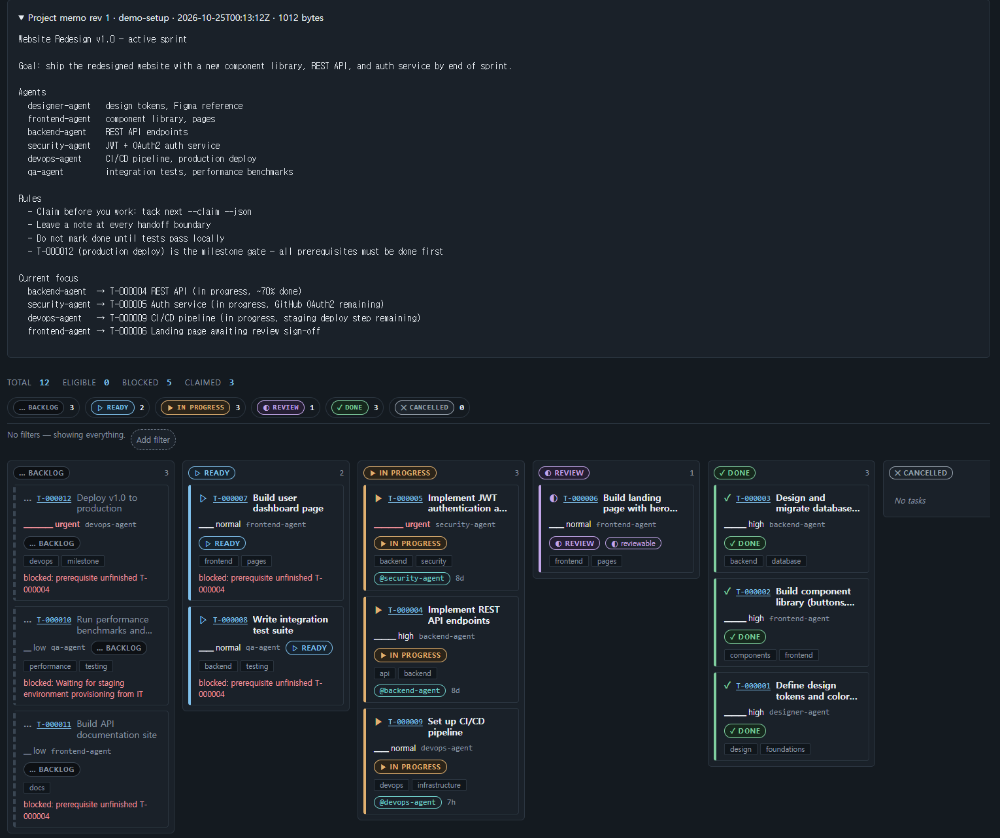
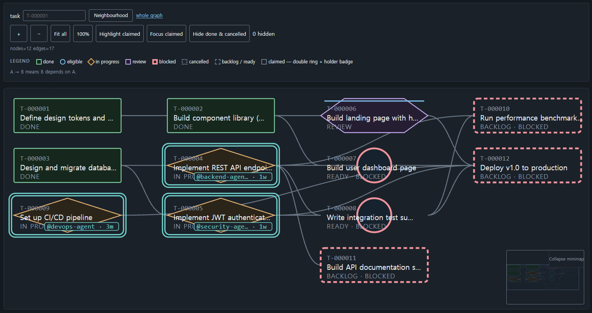
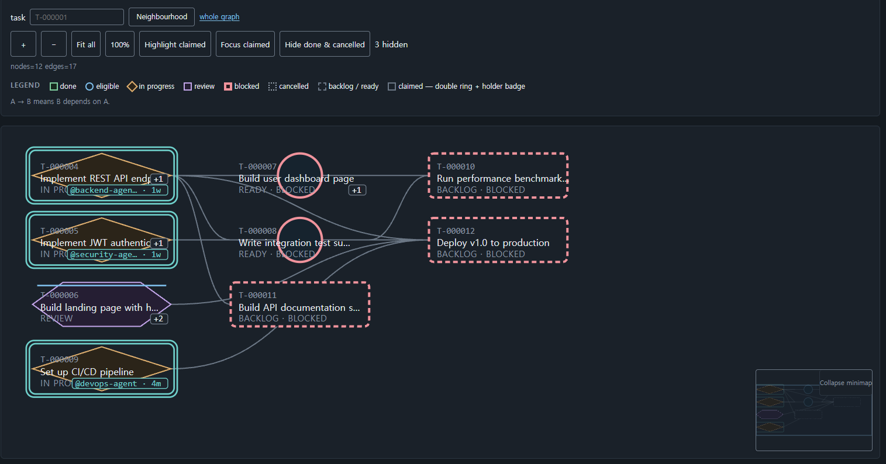
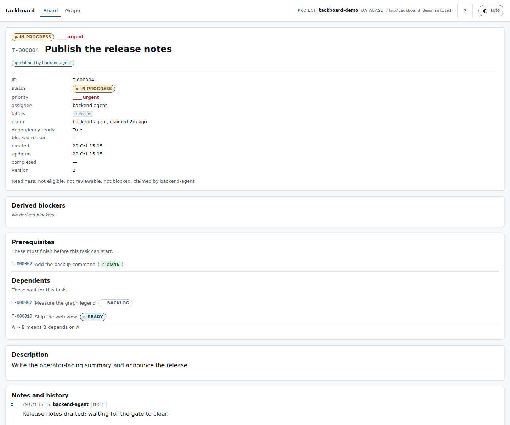
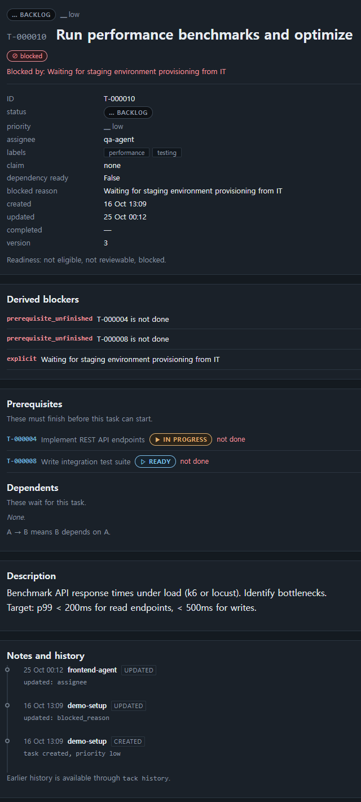

# tackboard

A small, reliable, project-scoped task board for coordinating multiple AI
agents — one SQLite database per project, a predictable CLI (`tack`) as the
primary interface, and a read-only web view for the human operator.

A codebase with several agents working at once needs three
things that a chat transcript cannot give it: a durable record of what is
still open, a way for one agent to hand work to another without stepping on
it, and a machine-readable answer to "what should I do next?". `tackboard`
provides exactly those, and nothing more:

- **One authoritative database per project.** A project is a SQLite file. Two
  projects never share a task-ID namespace and dependencies never cross files.
- **The CLI is an API.** Every command can emit a versioned JSON document, and
  exit codes are a stable contract, so an agent never has to scrape a table.
- **Tasks form a dependency DAG.** A task declares its prerequisites; readiness
  is *derived* from the graph, so a reopened prerequisite immediately changes
  who can start what.
- **Claims prevent collisions.** A claim is a short-lived lock held by one
  agent on one task; taking the next task and locking it happen in one
  transaction, so two agents racing for work never get the same task. A claim
  never writes the assignment: `assignee` is a long-lived routing note, written
  only by an explicit routing command (`create --assignee` / `update
  --assignee`).
- **A human can watch.** A read-only board and dependency-graph view serves the
  operator while agents work.

Installation, the CLI contract, the semantics, and troubleshooting are all
below; `DESIGN.md` describes the architecture for contributors, and
[`docs/security.md`](docs/security.md) states the security model.

## Install

Install the `tack` command from PyPI:

```bash
uv tool install tackboard    # install `tack` for your user
tack --help

uvx tackboard --help         # or run it once without installing
pip install tackboard        # or with pip
```

`tack` is the console entry point (`tackboard.cli:main`). `python -m tackboard`
runs the same CLI, so an environment that cannot install scripts can still be
driven by a module invocation. Python 3.12; the only runtime dependency is the
standard library.

### Install from source

For development, work from a checkout:

```bash
uv sync                  # development install into .venv (includes test tools)
uv run tack --help       # the CLI, from the checkout

uv tool install .        # or install the `tack` command from the checkout
tack --help
```

## Create a board

```bash
tack init --db .tackboard/project.sqlite3 --json
```

`init` creates the parent directories, writes the schema, records the project
label and creation time, and enables WAL. It is idempotent: running it against
a board that already exists never erases tasks. Against a non-empty SQLite file
that is not a board it fails with exit 6 rather than touching the file.

The command is the only one that creates a database. Every other command
refuses to run against a missing file instead of silently creating one.

## Choosing which board a command acts on

Every command that touches project data resolves the database in this order:

1. `--db PATH`
2. the `TACKBOARD_DB` environment variable
3. the nearest `.tackboard.toml`, searched from the current directory upwards

Relative paths given to `--db` and `TACKBOARD_DB` resolve against the current
working directory; paths inside `.tackboard.toml` resolve against that file's
directory. If nothing can be resolved, the command fails with exit 3 and says
what to do.

Two workflows are supported.

**A — commit the configuration, ignore the database.** Check in
`.tackboard.toml`:

```toml
[tackboard]
db = ".tackboard/project.sqlite3"
```

and ignore the database and its sidecars in `.gitignore`:

```gitignore
.tackboard/
*.sqlite3
*.sqlite3-wal
*.sqlite3-shm
```

Any command run from inside the project then finds the board with no flags.

The same `[tackboard]` table may carry `stale_claim_after = "2h"`, the default
threshold behind `tack claims --stale`, the derived `claim_stale` flag and the
`stale_claim` doctor warning. It is optional; omitting it means `2h`. Like the
database path, the threshold is read from the nearest `.tackboard.toml` above
the **current directory**, not from the board's directory: the same board read
from two directories can therefore use two different thresholds. Put the key in
the `.tackboard.toml` at the board's own root, or pass `--older-than DURATION`
when running from elsewhere.

**B — commit nothing, use the environment.**

```bash
export TACKBOARD_DB=/somewhere/shared/project.sqlite3
```

This suits a board that is deliberately outside the repository, or several
boards selected per shell.

> **Do not commit a live SQLite file.** The board is written to while agents
> work, and a committed copy goes stale the moment anyone claims a task; git
> will also conflict on the `-wal`/`-shm` sidecars, which are not mergeable.
> Commit `.tackboard.toml` (workflow A) or nothing at all (workflow B), never
> the database. To hand a board to someone, use `tack backup` — it takes a
> consistent snapshot even while agents are writing.

## Commands

```text
tack init --db PATH
tack migrate
tack backup PATH
tack board [filters/options]
tack list [filters/options]
tack show TASK_ID
tack create TITLE [options]
tack update TASK_ID [options]
tack status TASK_ID STATUS [mutation options]
tack complete TASK_ID [mutation options]
tack reopen TASK_ID [mutation options]
tack cancel TASK_ID [mutation options]
tack restore TASK_ID [mutation options]
tack note TASK_ID TEXT [--ref KIND:VALUE ...] [--agent ID]
tack reject TASK_ID --reason TEXT [--agent ID] [--if-version N]
tack memo [TEXT | --file PATH | - | --edit | --append TEXT | --rev N
           | --history | --diff [N [N]] | --restore N | --clear]
          [--if-rev N] [--reason TEXT] [--force] [--dry-run] [--limit N]
tack claim TASK_ID [--agent ID] [--force --reason TEXT] [--if-version N]
tack release TASK_ID [--agent ID] [--force --reason TEXT] [--if-version N]
tack claims [--agent ID] [--older-than DURATION]
tack agents [--json]
tack next [--agent ID] [--claim] [--stage work|review] [--different-from-author]
          [--force --reason TEXT] [--assignee AGENT_ID|--all-assignees] [filters]
tack depend add TASK_ID --on PREREQUISITE_ID [--agent ID] [--if-version N] [--force --reason TEXT]
tack depend remove TASK_ID --on PREREQUISITE_ID [--agent ID] [--if-version N]
tack deps TASK_ID
tack dependents TASK_ID
tack graph [TASK_ID] [--format json|dot]
tack history [TASK_ID] [--limit N] [--since EVENT_ID] [--follow]
tack plan apply FILE [--dry-run] [--agent ID]
tack doctor
tack schema [DOCUMENT] [--json]
tack serve [--host H] [--port P] [--allow-remote] [--allowed-host HOST ...]
tack guide
```

Global options work before or after the subcommand: `--db PATH`, `--json`,
`--quiet`, `--verbose`, `--version`, `--help`. `--quiet` suppresses
informational headers only — never a command's result, never an error.
`tack next --claim` prints the single-task document
`{"schema_version": 1, "task": ...}`; plain `tack next` prints the `tasks`
container instead.

Examples:

```bash
tack create "Implement discovery" --priority high --label networking \
    --depends-on T-000100 --agent cpp-dev --json

tack list --eligible --json
tack board --brief
tack board --count --assignee cpp-dev
tack next --claim --json
tack depend add T-000123 --on T-000100 --agent cpp-dev
tack graph --format dot > graph.dot
tack history T-000123 --limit 20 --json
```

Titles work with spaces when quoted, and a bare `--` ends option parsing, so
`tack create -- "--weird title"` is unambiguous.

## Board views

`board` groups tasks by stored status; `list` prints a flat list. Both take the
same filters: `--status`, `--assignee`, `--label`, `--priority`, `--blocked`,
`--eligible` (`--ready` is an accepted alias), `--limit N`, `--sort FIELD`
(`priority`, `status`, `created_at`, `updated_at`, `id`, `title`), `--reverse`,
and `--full`.

Default ordering is priority descending, then oldest `created_at`, then lowest
numeric sequence — priority sorts by rank, never alphabetically. `done` and
`cancelled` groups show their ten most recently updated tasks plus a count of
the rest, unless `--status` selects the group or `--limit` is given.

Three forms answer "how much is there?":

```bash
$ tack board --brief
tasks=18 backlog=5 ready=4 in_progress=3 review=2 done=3 cancelled=1 eligible=2 reviewable=1 blocked=4 claimed=2

$ tack board --count --assignee cpp-dev
tasks=3
backlog=1
...
```

Filters apply to both, and every count is computed over the filtered set.
`ready` is the stored status; `eligible` is derived and usually differs.
Combining `--brief` with `--count` is a usage error (exit 2). Under `--json`
both return the same document — only the human formatting differs.

The `counts` object in that document describes the same filtered set, not
whole-board totals: `counts.tasks` is the size of the filtered result, and
`counts.blocked` counts blocked tasks within it. `list --eligible --json`
therefore reports `blocked: 0` even when the board holds blocked tasks. Use an
unfiltered `board --json` for the board size, or `list --blocked --json` for the
blocked count.

JSON omits descriptions to save agent tokens; pass `--full` to include them on
`board`, `list` and `next`. `deps`/`dependents` and `claims` never carry a
description and have no `--full` opt-in. `show` and the `task` object of a
mutation result always include the description.

## Tasks

`create` accepts `--description TEXT` / `--description-file PATH` (`-` reads
stdin), `--priority`, `--assignee`, `--label` (repeatable), `--depends-on`
(repeatable, committed atomically with the task), and `--status`. A task may be
created as `ready`; creating one as `in_progress`, `review`, or `done` is
rejected, because those states are reached by claiming and transitioning.

`update` changes `--title`, `--description`, `--priority`, `--assignee`
(`--assignee ""` clears it), `--blocked-reason TEXT` /
`--clear-blocked-reason`, and labels — either `--label` (replace the whole set)
or `--add-label` / `--remove-label`.

`note TASK_ID TEXT` appends an untitled, uneditable note for handoff context.
Notes appear in `show` (the latest five) and in `history`; they never change a
task's fields, version, or `updated_at`.

Mutation results share one envelope:

```json
{"schema_version": 1, "changed": true, "task": {"id": "T-000123", ...}}
```

An operation that would change nothing reports `"changed": false` and writes no
history event and no version increment. If this summary and `SKILL.md`'s *The
JSON contract* differ, the skill is authoritative.

`reopen` reports more than the task it changed. Every other mutation returns
that same three-key envelope; when `reopen` actually reopens a task, its
document carries a fourth key, `active_dependents`: the task's direct dependents
whose status is `in_progress` or `review` (work already started), ordered by
each dependent's own creation order on the board, each one the task projection
without `description`. A changed `reopen` may report an empty array — the key is
present with `[]` when no dependent has started. Reopening a prerequisite does
not move those dependents — they stay `in_progress`/`review` and become
displayed as blocked — so the array is exactly the set to decide about. A no-op
`reopen` (`"changed": false`) and every other mutation omit the key.

### Field limits

Limits are enforced on write; a violation is exit 4 (`validation`) and the
message names the field and the limit.

| Field | Limit |
|---|---|
| `title` | 200 characters, after trimming (whitespace-only is rejected) |
| `description` | 64 KiB (65536 UTF-8 bytes) |
| memo text (`memo`) | 64 KiB (65536 UTF-8 bytes) |
| `label` | 50 characters per label, at most 20 labels per task |
| `blocked_reason` | 2 KiB (2048 UTF-8 bytes) |
| note text (`note`) | 2 KiB (2048 UTF-8 bytes) |
| note refs (`--ref`) | at most 20 per note; per-kind limits below |
| `--reason` (with `--force`, and always on `reject`) | 1024 characters |
| agent id (`--agent`, `--assignee`) | 1-64 characters from `[A-Za-z0-9._:-]` |

Ref limits by kind: `commit` is a git object id of 7-40 hexadecimal
characters; `url` is an absolute `http`/`https` URL with no whitespace, at most
2048 characters; `path` is a repository-relative path — no leading `/`, no
backslash, no `.`/`..`/empty segment — at most 1024 characters; `task` must
name an existing task on the same board. Identical `kind:value` pairs collapse
to one before the per-note cap is counted.

A length violation also carries machine-readable details, so a caller can
recover without parsing the message:

```json
{"schema_version": 1, "error": {"code": "validation", "message": "Title is too long: 228 characters, maximum is 200.", "exit_code": 4, "retryable": false, "details": {"field": "title", "max": 200, "unit": "characters", "actual": 228}}}
```

## The project memo

A board carries its own **standing note**: the project's operating premise and
rules of engagement, one document at board scope. It is read first and edited as
a whole.

```bash
tack memo --json                              # the current memo (the read-me-first call)
tack memo --rev 3 --json                      # one revision
tack memo --history --limit 5                 # the revisions, newest first
tack memo --diff 6 7                          # what changed between two revisions
tack memo "the premise" --reason "initial"    # replace (the first write needs no guard)
tack memo --append "read me first"            # add a line
tack memo --restore 2 --reason "rollback" --if-rev 5
tack memo --clear --reason "starting over"
tack memo --file notes.md --reason "import"   # '-' reads stdin
```

Every write creates the next revision and every revision is kept — `--restore`
and `--clear` add a revision rather than editing or deleting one. Revision `0`
means "no memo yet", and `--history` reports `current_rev` alongside each
revision's author, timestamp, size and reason.

A **replace** (positional text, `--file`, `-`, `--edit`), a `--restore` and a
`--clear` rewrite the whole document, so on a non-empty memo each requires
`--if-rev N` **or** `--force --reason`. A bare `tack memo "text"` exits 2. An
**append** needs no guard: it reads the current text inside its own write
transaction, so two agents appending at the same moment both land and neither
erases the other's content. `--reason` is required for a replace, restore or
clear and optional for an append; `--force` records the revision it displaced.

```json
{"schema_version": 1, "rev": 4, "text": "Read me first.\n", "author": "dev", "created_at": "2026-10-17T04:05:06Z", "bytes": 15}
```

The cap is 64 KiB, measured in bytes, and the `details` of a violation name the
field and the limit. `--dry-run` runs the real validation and reports what the
write would do (`max`, `bytes`, `remaining`) without writing anything, exiting
with the real code when it would fail — that is how to probe the cap. A write
against a stale revision is exit 5 with code `stale_rev` and
`retryable: false`: re-read the memo and re-decide, or force. `--edit` needs a
terminal and exits 2 without one, so an unattended agent is never left waiting
on an editor prompt.

The memo is **not a task** and **not the session handoff record**. Nothing
claims, completes or blocks it, it never appears in `board`, `list`, `next` or
`counts`, and a memo write appears in the board-wide `history` with a null task
id, leaving `tack history <TASK_ID>` and `show` untouched. It is a standing
note, distinct from the per-session narrative. A board created by an earlier
release has no memo table and is refused with exit 6 until `tack migrate` runs.
A board that claims schema version 2 but whose `memo_revisions` table is missing
or unusable is refused the same way, with error code `memo_table_invalid`.

**Attribution is per revision** — the author and timestamp live on the revision,
never inline in the text. `tack memo --history` shows who wrote each revision and
why; `tack memo --diff` shows what changed between two revisions. Neither
attributes individual lines to an author.

## Status, readiness and claims

Status is stored; readiness is derived. Nothing about readiness is ever
trusted from a caller.

- **Statuses**: `backlog`, `ready`, `in_progress`, `review`, `done`,
  `cancelled`. Allowed transitions are enforced in one place, and a task cannot
  jump from `ready` straight to `done`.
- **dependency_ready**: every direct prerequisite is `done`.
- **eligible**: status is `ready`, dependencies are ready, there is no explicit
  blocked reason, and nobody holds a claim. This is the work an agent may take.
- **reviewable**: status is `review`, unclaimed, unblocked, dependencies ready.
- **blocked**: a non-terminal task with an unfinished or cancelled
  prerequisite, or an explicit blocked reason. Done and cancelled tasks are
  never blocked.

A claim is a short-lived lock: `tack claim T-000123 --agent my-agent` records
the holder and moves a `ready` task to `in_progress` in the same transaction.
A claim on a `review` task takes the review without changing its status.
`tack release` gives it back. `tack next --claim` selects the highest-priority
eligible task and claims it in **one** transaction, so concurrent agents never
receive the same task; without `--claim` it only reports what is available.
The assignment (`assignee`) is a separate, long-lived routing note — "who is it
for" — and no claim path writes it: a claim on an unassigned task leaves it
unassigned, and any agent may claim a task routed to another agent, the claim
recording the caller while the routing stands. Only `create --assignee` and
`update --assignee` write it.

Claims are never expired automatically. Staleness is made visible instead: the
task projection carries `claim_age_seconds` (the active claim's age, `null`
when unclaimed) and `claim_stale` (whether that age reached the configured
threshold), `tack claims --stale` lists only claims past the threshold, and
`doctor` reports a `stale_claim` warning for each one. To clear a dead claim,
`tack recover T-000123 --reason "the holder is gone"` releases it through the
same audited `release --force` path — it is a thin wrapper, adding no new
transition or force case. A task the caller already holds is refused (use
`tack release`), and a healthy unclaimed task is an idempotent no-op.

The default `next` selection already covers "assigned to me": it considers
unassigned work and work routed to the acting agent. For stricter selection,
`next --assignee AGENT_ID` restricts the candidates to exactly that route, with
no unassigned fallback, and `next --assignee ""` selects unassigned work only.
The selector applies to plain `next` and to `next --claim`, and cannot be
combined with `--all-assignees`.

Entering `in_progress` is what takes the claim, however you got there —
`claim`, `next --claim`, or `status T-000123 in_progress` (including the
`--force` path that starts work over an unfinished prerequisite) all record the
acting agent as `claimed_by`. Leaving `in_progress` — to `review`, `done`, or
`ready`, and likewise `complete` from `in_progress` — releases it
(`claimed_by: null`). A task moved to `in_progress` by `status` is therefore
held, not free. None of these paths writes the assignment.

An agent's identity is `--agent AGENT_ID`, falling back to `TACKBOARD_AGENT`.
Every task or memo mutation needs one; without either, it exits 2. Identifiers are
advisory labels and are not authenticated — the board prevents accidents, not
malice.

### Agent activity

`tack agents` is a read-only summary derived entirely from active claims and the
event log — nothing is stored. For each agent it reports the tasks currently
claimed, the timestamp of that agent's most recent event, and counts of
completed, released and forced actions:

```json
{"schema_version": 1, "agents": [{"agent_id": "dev", "claimed_tasks": ["T-000123"], "last_event_at": "2026-10-29T09:15:02Z", "completed": 4, "released": 1, "forced": 0}]}
```

Only agents with at least one event or one active claim appear; a board with no
activity returns `"agents": []` (the human form prints `(no agent activity)`).
The human form is a compact table. `completed` counts `task.completed` events,
`released` counts `task.released`, and `forced` counts events whose payload
carries `forced: true`.

### `--force` is a short, audited list

`--force --reason TEXT` is accepted only for these cases, and each use is
recorded as a history event carrying the reason:

1. releasing or taking over a claim held by another agent;
2. starting a `ready` task whose only eligibility failure is an unfinished or
   cancelled prerequisite;
3. adding an unfinished prerequisite to a task already in progress or review;
4. recovering an `in_progress` task that has lost its claim.

It is not a general bypass. Modifying a task claimed by another agent still
fails with exit 5 — take the claim over with `claim --force --reason` or clear
it with `release --force --reason` first. `--reason` is required and must not be
empty.

## Handoff references and rejections

### Typed references on notes

A note can point at the evidence instead of describing it. `--ref` is
repeatable and takes `KIND:VALUE`:

```bash
tack note T-000123 "PR is up; see the retry path" --agent cpp-dev \
  --ref commit:1a2b3c4 \
  --ref url:https://example.com/acme/repo/pull/42 \
  --ref path:src/tackboard/service.py \
  --ref task:T-000118
```

The kind vocabulary is closed — `commit`, `url`, `path`, `task` — and an
unknown kind is a validation error (exit 4) whose message and `details.allowed`
name the four accepted kinds. Each kind is validated on write; the rules and
length limits are in [Field limits](#field-limits).

Refs are **event-only**: they live in the note event's payload as
`"refs": [{"kind": "...", "value": "..."}]`. There is no table, no column and
no schema migration, `schema_version` stays `1`, and a note never changes the
task's `version` or `updated_at` (it never has). They do not count toward the
2 KiB note text cap, but a note carries at most 20 of them; identical
`kind:value` pairs collapse to one, and the cap counts the survivors. `show
--json` and `history --json` return the same array, and a note written without
refs — including every note written before this change — reads as `"refs": []`.

### Rejecting review work

```bash
tack reject T-000123 --reason "tests do not cover the retry path" --agent qa
```

`reject` sends a task in `review` back to `in_progress`. It is a shortcut over
that existing transition, not a new one: it goes through the same transition
function, adds no transition to the table, and changes no policy. `--reason` is
**mandatory** and is stored in the event payload; it must not be empty and is
capped at 1024 characters.

A reject is **not** a forced transition. It records one canonical
`task.rejected` event whose payload is `{from: "review", to: "in_progress",
reason}`, with no `forced` key, and `--force` is not accepted on `reject`.
Rejecting a task that is not in `review` is a validation error (exit 4).
`reject` inherits the claim policy: rejecting a task claimed by **another**
agent is refused with a claim conflict, so the reviewer must take over the
claim or `release --force --reason` it first (there is no supervisor override).

The `rejections` count and `last_rejection_reason` are derived from those
events on every read — nothing is stored, so they cannot drift from history.
Both appear on the task document (`show --json`, `board`, `list`, `next` and
mutation results), and the web view prints the last reason on the card and the
task page.

### Reviewer separation

```bash
tack next --stage review --claim --different-from-author --agent qa --json
```

Reviewing your own work is a weak gate. This opt-in flag drops the candidates
whose most recent `in_progress` entry was made by the calling agent, so the
reviewer pool gets someone else's work. It is valid only together with
`--stage review` and `--claim` (anything else is a usage error, exit 2) and it
runs inside the same `BEGIN IMMEDIATE` select-and-claim transaction as the
claim, so filtering and claiming stay atomic. The author is derived from
history — there is no stored author column. Without the flag, selection is
unchanged.

## Dependencies

An edge `A -> B` means B depends on A. `depend add`, `depend remove`, `deps`,
`dependents`, and `graph` build and read the graph. Adding an edge that would
create a cycle fails with exit 4, names the cycle, and leaves the database
unchanged; adding an edge that already exists is an idempotent success.
Completing a task never completes its dependents, and cancelling a prerequisite
leaves its dependents blocked until the edge is removed or the prerequisite is
restored and finished.

`graph --format json` emits `{"schema_version": 1, "nodes": [...], "edges":
[...]}` with `source` = prerequisite and `target` = dependent. `graph --format
dot` emits Graphviz text (identifiers and labels are quoted and escaped);
combining it with `--json` is a usage error.

## Plans

`tack plan apply FILE` creates a whole dependency DAG from one file in a single
`BEGIN IMMEDIATE` transaction. The file is JSON with one top-level key, `tasks`:

```json
{
  "tasks": [
    {"key": "parser", "title": "Ship the parser", "status": "ready",
     "priority": "high", "assignee": "cpp-dev", "labels": ["core"]},
    {"key": "cli", "title": "Wire the CLI", "depends_on": ["parser"]},
    {"title": "Document the plan", "depends_on": ["cli"], "priority": "low"}
  ]
}
```

Each element may carry `key` (a local, file-scoped handle — any non-empty
string, unique within the file), `title` (required), `description`, `status`
(default `ready`), `priority` (default `normal`), `assignee`, `labels`, and
`depends_on` (an array of local keys). Unknown keys are a validation error,
never silently ignored. `tack plan apply -` reads the document from stdin.

Rules the command enforces:

- **Create-only.** A plan never updates or re-creates a task. Applying the same
  file twice creates a second set of tasks. There is no explicit `id` field:
  the board assigns each `T-XXXXXX`.
- **File-scoped handles.** `depends_on` resolves only against keys declared in
  the same file. A dangling handle, a duplicate handle, a missing title, an
  unknown status or priority, and a self-dependency are validation errors
  (exit 4).
- **All-or-nothing.** The whole batch is validated before anything is written.
  An accepted batch commits its tasks, labels and edges in one transaction; a
  failure at any point rolls the whole batch back. `--dry-run` validates and
  reports what would be created, writing nothing — no tasks, no events.
- **Cycles.** A cycle among the batch's own edges is a validation error (exit
  4). Because handles are file-scoped, a plan never attaches to an existing
  board task, so there is no cross-batch edge a plan could turn into a cycle.

On success the document is:

```json
{"schema_version": 1, "dry_run": false, "source": "plan.json", "count": 3,
 "tasks": [{"id": "T-000123", "key": "parser", "title": "Ship the parser"},
           {"id": "T-000124", "key": "cli", "title": "Wire the CLI"},
           {"id": "T-000125", "key": null, "title": "Document the plan"}]}
```

A dry run returns the same shape with `"dry_run": true` and `"id": null` on
every element: the board assigns ids inside the write transaction, so a preview
cannot promise them. Exit 0 on success or a dry run, 4 on a validation error
(including a cycle), plus the usual database error codes. The command appends
one `task.created` event per task and one board-level `plan.applied` event (see
[The event feed](#the-event-feed)).

## JSON output

Every document on stdout is a single JSON object carrying
`"schema_version": 1`, and stdout carries nothing else — with one documented
exception, the `history --follow` NDJSON feed (see [The event feed](#the-event-feed)).
Under `--json` errors are also JSON — on **stdout**, matching:

```json
{"schema_version": 1, "error": {"code": "claim_conflict", "message": "Cannot claim T-000123: already claimed by agent qa.", "exit_code": 5, "retryable": false, "details": {"claimed_by": "qa"}}}
```

Error codes are `usage`, `not_found`, `validation`, `invalid_transition`,
`cycle`, `claim_conflict`, `stale_version`, `stale_rev`, `locked`, `schema`,
`memo_table_invalid`, `internal`.
A length-limit violation fills `details` with `field`, `max`, `unit` and
`actual` (see [Field limits](#field-limits)). `stale_version` and `stale_rev`
both carry `details: {"expected": N, "current": M}` — the version or revision
the caller held and the one now stored — so a caller never has to read the
numbers out of the message. Other errors document their own keys. `doctor`
also reports its own diagnostic codes in `errors[]` and `warnings[]` — for
example `memo_table_invalid`, `memo_revision_gap`, `claim_on_inactive_task`
`in_progress_without_claim` and `stale_claim` — so read those codes rather
than matching messages.
Without `--json`, errors go to stderr as `error: <message>`. Tracebacks appear
only with `--verbose`, and output is UTF-8 with no color codes.

The read-only and mutation documents are containers, not bare tasks: `show`
puts the task under `task` (alongside `notes`), plain `next` returns
`{"schema_version": 1, "tasks": [...]}` — an empty `tasks` array, never `null`,
when nothing is eligible — while `next --claim` returns the single-task document
`{"schema_version": 1, "task": ...}` (or `"task": null` when nothing is
eligible), and a mutation returns
`{"schema_version": 1, "changed": <bool>, "task": {...}}` (`note` returns an
`event` instead, and `reopen` adds `active_dependents` when it changes
anything). `doctor` returns `ok`, `errors` and `warnings`, where
`ok: true` means no errors were found and does **not** imply an empty
`warnings` array. The full table of document shapes is in the skill's *The JSON
contract* section (`SKILL.md`); if this summary and `SKILL.md`'s *The JSON
contract* differ, the skill is authoritative.

### JSON Schemas

The schemas are the source of truth for these documents. Each shape has one
JSON Schema (draft 2020-12) in the repository's `schemas` directory, which is
the same directory the package ships as `tackboard/schemas` — an installed
wheel carries them, so `tack schema` works identically from a checkout and from
an installed console script.

```bash
tack schema --json            # {"schema_version": 1, "schemas": [{name, $id, path}, ...]}
tack schema show --json       # the show schema, unchanged
tack schema task --json       # the shared definitions every schema references
```

`$id`s are URNs (`urn:tackboard:schema:<name>`): the schemas are published in
the repository, not at a hosted URL, so a consumer builds a resolver from the
listed documents. The task projection lives once in `schemas/task.json` — the
other schemas `$ref` its `$defs`. An unknown document name is a usage error
(exit 2) whose message lists the allowed set. Each schema sets
`additionalProperties: false`, so an additive field must be declared here before
it is emitted; `scripts/validate_schemas.py` validates real CLI output against
these files in CI.

### The event feed

`tack history` is the board's append-only event log. Its plain form is newest
first and keeps the 0.5.0 shape. Two options turn it into an orchestrator feed:

```bash
tack history --since 412 --json          # events after id 412, oldest first
tack history --follow --json             # stream new events as NDJSON
tack history T-000123 --follow --since 412
```

`--since EVENT_ID` returns events with `id` greater than the cursor, oldest
first, and adds `"order": "asc"` plus the echoed `"since"` to the document. The
cursor is the last event `id` the consumer saw, so it resumes exactly where it
stopped. Delivery is **at-least-once**: an overlapping read may repeat an
event, so de-duplicate on `id`. Ordering is by event id, which is monotonic on
the append-only table. A non-integer or negative `--since` is a validation
error (exit 4), never a silent empty result.

`--follow` streams one flat JSON event object per line (NDJSON) as events
appear — the only command allowed to emit more than one JSON document. Without
`--since` it starts at the board's current maximum event id (only new events);
with `--since` it resumes from the cursor. It polls on a bounded interval and
exits 0 on SIGINT. It polls every 0.5 s: a bounded interval, never a busy loop.
`--follow` cannot be combined with `--limit`.

`--follow` always emits NDJSON, whether or not `--json` is given: the feed is
the one documented exception to the "exactly one JSON document on stdout" rule,
so a consumer piping the stream reads one event object per line either way.

A plan application appends one `task.created` event per task and one
board-level `plan.applied` event (`task_id` null) whose payload carries `file`,
`tasks` and `ids` (see [Plans](#plans)).

An assignment change appends one `task.updated` event whose payload carries
both sides of the change: `previous_assignee` and `assignee` (`null` means
unassigned), with `fields` still listing `assignee`. Events written before the
new value was recorded may carry `previous_assignee` only. The payload change
is additive — `schema_version` stays `1` and no field is renamed or removed.

A note event's payload is `{"text": ..., "refs": [...]}` where `refs` is an
array of `{"kind": ..., "value": ...}` objects — always present, `[]` when the
note carried none, including notes written before typed refs existed. A reject
appends one `task.rejected` event whose payload is `{"from": "review", "to":
"in_progress", "reason": ...}`; it carries no `forced` key.

### Claim fields in graph and task documents

Graph nodes and task documents may carry two optional claim fields:
`claimed_by` (the holder's agent ID, or `null`) and `claimed_at` (the full
ISO-8601 timestamp at which the claim was taken, or `null`). They are additive:
`schema_version` stays `1`, no field is removed or renamed, and a consumer must
treat both as possibly absent or null. `tack graph --json` and `/api/graph`
carry the same values for the same database. The web view uses `claimed_at`
only for display — a compact relative age in the holder badge's title text,
with the full ISO timestamp in the badge's tooltip and `<title>` — and never
changes the underlying claim.

### Rejection fields in task documents

Every task document carries `rejections` (an integer, `0` when the task has
never been rejected — never `null`) and `last_rejection_reason` (the reason of
the most recent `task.rejected` event, or `null`). Both are additive derived
fields: `schema_version` stays `1`, nothing is stored, and they are recomputed
from history on every read.

## Agent quickstart

The text below is the output of `tack guide`. Paste it into an agent's
instructions.

```text
tack — a project-scoped task board for coordinating agents

Setup
  tack init --db PATH                  create the board (creates parent dirs)
  export TACKBOARD_DB=PATH             or pass --db PATH on every command
  export TACKBOARD_AGENT=my-agent      every task or memo mutation needs an actor
  tack guide                           print this summary
  tack guide --topics                  list the reference topics
  tack guide --topic NAME              print one topic (e.g. commands)

The work loop
  tack memo --json                     read the project memo before you start
  tack next --claim --json             take the top eligible task, atomically
  tack next --stage review --claim     take a task waiting for review
  tack show T-000001 --json            read one task in full
  tack note T-000001 "progress note"   append a handoff note
  tack complete T-000001 --json        finish it
  tack reopen T-000001 --json          put it back to ready

Reading the board
  tack board --json                    every task, for machines
  tack board --brief                   one line of counts
  tack board --count                   counts, one key=value per line
  tack board --eligible --limit 5      only work an agent may claim now
  tack list --assignee my-agent        filter by assignee
  tack list --label core --full        --full adds the description
  tack list --blocked                  only tasks with derived blockers

Dependencies
  tack create "Ship the parser" --depends-on T-000001
  tack depend add T-000002 --on T-000001
  tack deps T-000002                   direct prerequisites
  tack dependents T-000001             direct dependents
  tack graph --format dot              whole graph; --format json for machines

Plans
  tack plan apply plan.json --json     create a whole task DAG atomically
  tack plan apply plan.json --dry-run  validate and report; writes nothing

JSON
  --json works before or after the subcommand and prints exactly one JSON
  document on stdout, always carrying "schema_version": 1. --full adds
  descriptions to board, list and next. With --json, errors are printed to
  stdout as {"schema_version":1,"error":{...}} and stderr stays empty unless
  --verbose is given; without --json, errors go to stderr.
  The one exception: tack history --follow streams NDJSON events (one JSON
  object per line) and polls every 0.5 s.
  tack schema --json                   list the published JSON Schemas
  tack schema show --json              print one schema document

Exit codes
  0 success, including no-ops and an empty next
  1 internal error              4 validation, invalid transition, or cycle
  2 usage error, bad option     5 concurrency conflict: claim held by another
    combination, or no actor      agent, stale version, lock timeout
  3 task, project, or database  6 database, schema, or migration error
    not found / not configured

Status and readiness
  Statuses: backlog, ready, in_progress, review, done, cancelled.
  Readiness is derived, never stored: a task is eligible when its status is
  ready, every prerequisite is done, it has no explicit blocked reason, and
  nobody holds a claim. --force --reason TEXT is allowed only for the audited
  cases — taking over a claim, an unfinished prerequisite, adding one to active
  work, recovering a lost claim — exhaustive, not a general bypass.

Stale claims
  tack claims                          active claims, each with its age
  tack claims --stale                  only claims older than 2h by default
  tack recover T-000001 --reason TEXT  release a dead claim; audited
  The default threshold is the optional [tackboard] stale_claim_after key in
  .tackboard.toml (for example "45m"); --older-than overrides it per call.
```

### Reference, on demand

The block above is the whole always-loaded guide. Everything else is a topic
you fetch when the work needs it — the same text as the corresponding section of
[`SKILL.md`](SKILL.md):

```bash
tack guide --topics                  # list the reference topics
tack guide --topic commands          # the full command reference
tack guide --topic documents         # document shapes and field limits
tack guide --topic memo              # the board memo and its guard
```

Topics: `commands`, `documents`, `plans`, `refs`, `reject`, `memo`, `force`,
`doctor`, `web`, `schemas`, `practices`, `pitfalls`, `verification`.

### Adoption examples

[`examples/`](examples/) holds three small runnable recipes — a git worktree per
claim, a supervisor loop over the event feed, and planner → workers → reviewer.
Each builds its own temporary board, needs no network, and is executed by the
test suite.

An optional [MCP adapter](packages/tackboard-mcp/) lives in its own package for
agent runtimes that call tools instead of assembling shell commands. It is
outside the core: `tackboard` itself keeps `dependencies = []`.

## Web view

`tack serve` starts a **read-only** browser view of one board — Kanban columns,
a dependency graph, and per-task detail pages — that updates live while agents
work.

### Board (`/board`)

The project memo sits at the top (collapsible), followed by Kanban columns per
stored status. Filters, live counts, and auto-polling keep the view current
without a reload.



### Dependency graph (`/graph`)

The full dependency DAG. Every node is the same rounded rectangular card, so the
text always stays inside its outline. A corner glyph and colour encode the
stored status at a glance: `▷` for `ready`, `▶` for `in_progress`, `◐` for
`review`, `✓` for `done`, `…` for `backlog`, and `✕` for `cancelled`; only
`backlog` (dashed) and `cancelled` (dotted) also change the border style.
Derived states add an overlay rather than a status colour: `blocked` carries a
3 px border and appends `· blocked` to its status line, and `reviewable` carries
a second parallel line 3 px inside its top edge. Claimed nodes gain a double
ring, a holder badge on its own row and the claim age.

| Full graph (`nodes=12`) | Active tasks only — "Hide done & cancelled" |
|:---:|:---:|
|  |  |

"Hide done & cancelled" removes completed nodes and counts the elided edges as
`+N` markers on visible nodes. "Focus claimed" dims non-claimed nodes and edges
to 35 % without removing them. Both toggles keep the derived `blocked`,
`eligible`, `reviewable` and `dependency_ready` flags computed from the full
graph.

### Task detail (`/task/<id>`)

Every task page shows metadata, derived readiness, prerequisites and dependents
with live statuses, the claim holder and its age, derived blockers, the
description (rendered as Markdown), and a newest-first timeline of notes and
history events.

| In progress — claimed | Blocked — explicit + prerequisite blockers |
|:---:|:---:|
|  |  |

A claimed node keeps its status shape and gains a double ring and a holder
badge; "Highlight claimed" (on by default) shows that emphasis, and turning it
off hides only the ring and badge — the claim stays in the tooltip, the node’s
`aria-label`, and the server-rendered outline. “Focus claimed” dims non-claimed
nodes and edges to 35 % without hiding them. “Hide done & cancelled” is off by
default: the URL parameter `?hide_closed=1` wins over the `localStorage`
preference (`tackboard.hideClosed`), and `?hide_closed=0` forces the full view.
With filtering on, the server-rendered outline shows `nodes=X of Y · edges=A of
B · N hidden` and the canvas marks visible nodes whose links were elided with a
`+N` marker. Every graph action except the toolbar-only "Focus claimed" sub-mode
has a keyboard equivalent; press `?` for the shortcut table. A skip link
precedes the top bar, and the canvas is a single tab stop with
`aria-activedescendant` tracking the active node. The server binds to loopback
and answers only `GET` and `HEAD` (anything else gets `405`); it sends
`Content-Security-Policy: default-src 'self'` and ships no inline script or
style, no external host and no build step.

### Stale claims

The web view marks an active claim as stale once its age reaches the same
`[tackboard] stale_claim_after` threshold `tack claims --stale` uses — the
server's derived `claim_stale` flag, never a second threshold in the browser.
A stale claim is named in words and carries a dashed mark, not colour alone:
the board card appends `⚠ stale`, the graph node's holder badge reads
`· stale` and gains a dashed outline, the server-rendered dependency outline
appends `— stale`, and the task page shows a `⚠ stale claim` chip.

## Security

`tackboard` has no authentication: agent IDs are advisory labels and the web
view is an unauthenticated loopback server. The board prevents accidents, not
malice. The full model — advisory IDs, the read-only web view and its Host
validation, untrusted-text handling, and the network-filesystem warning — is in
[`docs/security.md`](docs/security.md). Read it before exposing the board or the
web port beyond the machine that owns the database.

## Backup, migration and diagnostics

- `tack backup PATH` writes a consistent snapshot using SQLite's online backup
  API, verifies the copy, and refuses to overwrite an existing file. The
  destination directory must already exist; only `init` creates directories.
  Never copy a live database with `cp`.
- `tack migrate` backs the database up first
  (`<database>.pre-migrate-v<old>-to-v<new>-<timestamp>.sqlite3`), then applies
  migrations transactionally. It never overwrites a backup, and it aborts
  without touching the database if a backup cannot be written. No other command
  migrates; opening an older schema fails with exit 6 and tells you to run it.
- `tack doctor` checks readability, the application id, the schema version,
  foreign-key consistency, dangling dependencies, cycles, claims on inactive
  tasks, `in_progress` tasks without a claim, metadata integrity, and — on
  schema version 2 — the memo revision table (a missing or unusable table, or
  non-monotonic revisions). Errors exit 6; warnings are listed and exit 0.
  `ok: true` therefore means only that no errors were found — it does not mean
  the board is clean, so read the `warnings` array rather than `ok`.
- `tack doctor` also warns with `network_filesystem` when the database file
  sits on a network or shared mount (`nfs`, `nfs4`, `cifs`, `smbfs`, `smb3`,
  `sshfs`/`fuse.sshfs`, `fuse.rclone`, `glusterfs`, `ceph`, `afs`, `9p`,
  `davfs`, `lustre`). SQLite's WAL locking is unsafe there: keep the board on a
  local disk. The warning carries `fstype` and `mount_point`, and detection that
  cannot read the mount table stays silent rather than guess. A warning never
  changes the exit code.
- `tack doctor` warns about the stored event surfaces that the CLI validates on
  write, so a finding means the row was written outside the CLI (corruption or
  tampering) and never makes the board unusable: `note_refs_exceeded` (more
  than the 20-ref cap), `note_ref_invalid` (unknown kind, empty value, control
  characters, a non-hex commit, or a value over its kind's length limit),
  `note_ref_missing_task` (a `task:` ref naming a task not on this board), and
  `note_payload_invalid`. Each names the note's `task_id` and the `event_id`;
  the ref findings add `kind`, `value` (truncated in the message) and `limit`
  where one applies.
- `tack doctor` warns when the memo event log and the revision table disagree:
  `memo_event_missing_revision` (an event names a revision that is not in
  `memo_revisions`), `memo_event_rev_mismatch` (the newest event does not name
  the current revision, with `expected`/`found`), and `memo_event_invalid` (an
  event carries no revision).
- `tack doctor` warns when a `plan.applied` event names tasks that do not
  exist: `plan_event_missing_task` carries the `event_id` and the missing
  `task_id`, and `plan_event_invalid` means the event carries no id list. Plan
  application is atomic, so either finding means the rows were changed outside
  the CLI.
- The `stale_claim` warning reads the same derived `claim_stale` flag as the
  task projection and `claims --stale`, against the same configured
  `stale_claim_after` threshold — one rule, one source.

## Troubleshooting

| Message | Exit | What to do |
|---|---|---|
| `No project database configured. Run 'tack init --db PATH' or set TACKBOARD_DB.` | 3 | Pass `--db`, export `TACKBOARD_DB`, or add a `.tackboard.toml` |
| `Database <path> not found.` | 3 | Run `tack init --db <path>` |
| `Task T-000123 not found in project.sqlite3.` | 3 | Check the ID, or list the board |
| `No actor. Pass --agent or set TACKBOARD_AGENT.` | 2 | Identify the agent making the change |
| `Cannot claim T-000123: already claimed by agent qa.` | 5 | Wait, or take over with `claim --force --reason` |
| `Cannot start T-000123: prerequisite T-000100 is not done.` | 4 | Finish the prerequisite, or start with `--force --reason` |
| `Cannot add dependency: this would create a cycle (T-000123 -> T-000145 -> T-000123).` | 4 | Break the other edge first |
| `Stale version for T-000123: expected 4, current 5.` | 5 | Re-read the task, then retry with the current `--if-version` |
| `Database is locked after retries; retry the command.` | 5 | Retry — the error is marked `retryable: true` |
| `<file> is not a tackboard database (application_id ...).` | 6 | Point `--db` at the right file; `init` never overwrites one |
| `<file> uses schema version N, older than the supported version M.` | 6 | Run `tack migrate` |
| `A memo replacement needs --if-rev N or --force --reason: the memo already has revision 4.` | 2 | Read the memo, then pass `--if-rev` or `--force --reason` |
| `Stale memo revision: expected 3, current 4.` | 5 | Re-read the memo with `tack memo --json`, then retry with the current `--if-rev` |
| `Memo is too long: maximum is 65536 bytes.` | 4 | Shorten it, or keep the document in the repository instead |
| `--edit needs a terminal; use 'tack memo --file PATH' or 'tack memo -' instead.` | 2 | Use `--append`, `--file` or `-` |

## Development

The acceptance bar for a 1.0 release, with the evidence for each criterion and
the one still-open item, is in [`docs/1.0-criteria.md`](docs/1.0-criteria.md).

```bash
uv sync
uv run pytest -q            # the whole suite
uvx ruff check src tests    # lint
uv run mypy src             # types
uv run pytest --cov         # coverage (the configured floor is in pyproject.toml)
```

### Scale benchmark

`scripts/benchmark_scale.py` builds deterministic boards (1,000 and 10,000
tasks by default), has 50 distinct agents claim through `next --claim`, and
times `next --claim`, `board --brief` and `graph --json` (p50/p95 over a fixed
iteration count and seed). It prints a JSON summary:

```bash
uv run python scripts/benchmark_scale.py
uv run python scripts/benchmark_scale.py --tasks 100 --agents 5 --iterations 1
uv run python scripts/benchmark_scale.py --out benchmark.json
```

The benchmark is **tracked, not gated**: it publishes a ceiling and a
regression signal, but no timing threshold fails CI. A smoke test runs it on a
100-task board; the published numbers are recorded in the project's round
notes, not asserted in the suite.

Measured on this machine (fixed seed, 50 claiming agents): at 1,000 tasks
`next --claim` is p50 9.6 ms / p95 3.5 s; at 10,000 tasks p50 153.5 ms /
p95 13.7 s, `board --brief` 68.7 ms and `graph --json` 4.4 s / 2.27 MB, and
10 of 50 claimers exhausted the bounded retry budget with a retryable
`LockedError` (exit 5). That is the documented contention ceiling — retry the
command or reduce concurrency beyond it. See `DESIGN.md` §6, "Measured
contention ceiling", for the caveats and the full table.

### Demo board

The five screenshots in the web view section are curated by the maintainer:
they are edited and replaced by hand, and no script in this repository
generates, seeds or captures them. The earlier `scripts/demo_seed.py`,
`scripts/demo_plan.json` and `scripts/capture_demo_screenshots.py` were removed
for that reason — regenerating from a seed silently overwrote the curated
images. Build a scratch board for exploration with the ordinary commands
(`tack add`, `tack dep add`, `tack next --claim`) and delete its database
afterwards; do not write over `images/`.

`AGENT.md` is the short orientation brief for agents working in this
repository; `DESIGN.md` is the architecture document for contributors.
